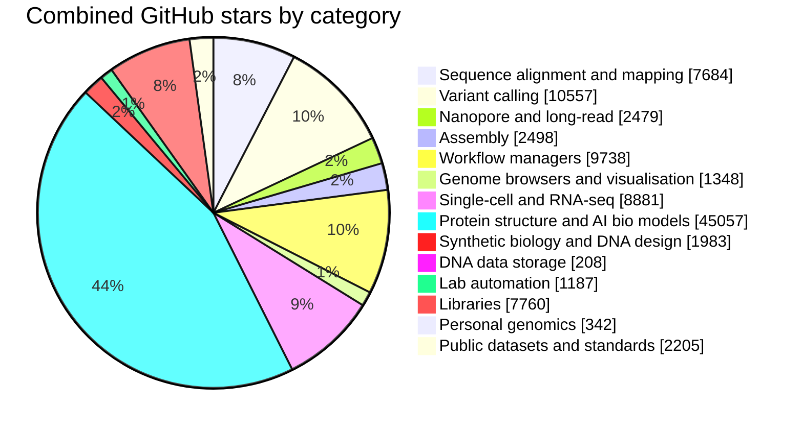

# Awesome Craft DNA 

> A curated list of open-source tools for DNA, genomics and synthetic biology.

This list covers open-source software for reading, writing, analysing and designing DNA, RNA and proteins: aligners, variant callers, long-read tools, assemblers, workflow managers, genome browsers, single-cell and RNA-seq packages, structure and sequence models, synthetic-biology design tools, DNA storage codecs, lab automation, libraries, personal-genomics utilities, and public datasets and standards. Every entry below has a public repository that was checked on 2026-11-15. Check each project's licence, including any separate terms for model weights, before you use it.

**Biosafety and ethics:** this list is for research, engineering and education. It is not guidance on pathogen enhancement, gain-of-function work, or the design of harmful biological agents, and it does not list tools whose purpose is that work. Sequence models and gene-editing design tools can be dual-use. Use them only in line with the law, institutional biosafety rules, and each project's own terms.

**Privacy:** personal and consumer genomic files are sensitive. Prefer tools that run on a machine you control, do not upload raw genotypes to a third-party service unless you understand and accept that service's terms, and never post those files in public issues, chats or repositories.

## Contents

- [Dashboard](#dashboard)
- [Sequence alignment and mapping](#sequence-alignment-and-mapping)
- [Variant calling](#variant-calling)
- [Nanopore and long-read](#nanopore-and-long-read)
- [Assembly](#assembly)
- [Workflow managers](#workflow-managers)
- [Genome browsers and visualisation](#genome-browsers-and-visualisation)
- [Single-cell and RNA-seq](#single-cell-and-rna-seq)
- [Protein structure and AI bio models](#protein-structure-and-ai-bio-models)
- [Synthetic biology and DNA design](#synthetic-biology-and-dna-design)
- [DNA data storage](#dna-data-storage)
- [Lab automation](#lab-automation)
- [Libraries](#libraries)
- [Personal genomics](#personal-genomics)
- [Public datasets and standards](#public-datasets-and-standards)
- [Related lists](#related-lists)
- [Star history](#star-history)

## Dashboard

<table>
<tr>
<td align="center"><h2>63</h2>listed projects</td>
<td align="center"><h2>14</h2>categories</td>
<td align="center"><h2>101.9k</h2>combined GitHub stars</td>
<td align="center"><h2>25.0k</h2>combined forks</td>
<td align="center"><h2>39/63</h2>pushed in the last 30 days</td>
<td align="center"><h2>14</h2>languages</td>
</tr>
</table>

**Evidence tags**

<table>
<tr><th>Tag</th><th>Style</th><th>Meaning</th></tr>
<tr><td>FACT</td><td>solid underline</td><td>A measured figure, with the source named.</td></tr>
<tr><td>GOAL</td><td>dashed underline</td><td>A stated roadmap or plan, not a result.</td></tr>
<tr><td>ESTIMATE</td><td>dotted underline</td><td>A sum or count we computed from the facts.</td></tr>
</table>

This snapshot has no GOAL figures. None of the dashboard numbers come from project roadmaps.

**Sources and method**

- Star counts, fork counts, licences, primary languages and last-push dates are FACT values from the GitHub REST API (`GET /repos/{owner}/{repo}`) on 2026-11-15.
- Combined stars (101.9k) and combined forks (25.0k) are ESTIMATEs: the arithmetic sum of those per-repository FACT counts, with no weighting and no unique-user deduplication. A person who stars two projects is counted twice.
- Pushed in the last 30 days (39/63) is an ESTIMATE: the number of listed repositories whose FACT `pushed_at` date is on or after 2026-10-16.
- Language and category counts, and the licence badges, are ESTIMATEs of FACT fields. Star badges next to each entry update live and may differ from this snapshot.

### 🏆 Leaderboard

Star counts in this table are FACT values from the snapshot. The bars are only a visual scale.

<table>
<tr><th>Rank</th><th>Project</th><th>Kind</th><th align="right">Stars</th><th></th></tr>
<tr><td align="center">🥇</td><td><b>AlphaFold 2</b></td><td>Protein structure and AI bio models</td><td align="right">14.9k</td><td><code>████████████████████</code></td></tr>
<tr><td align="center">🥈</td><td><b>AlphaFold 3</b></td><td>Protein structure and AI bio models</td><td align="right">8.8k</td><td><code>████████████</code></td></tr>
<tr><td align="center">🥉</td><td><b>Biopython</b></td><td>Libraries</td><td align="right">5.3k</td><td><code>███████</code></td></tr>
<tr><td align="center">4</td><td><b>Evo 2</b></td><td>Protein structure and AI bio models</td><td align="right">4.3k</td><td><code>██████</code></td></tr>
<tr><td align="center">5</td><td><b>Boltz</b></td><td>Protein structure and AI bio models</td><td align="right">4.3k</td><td><code>██████</code></td></tr>
<tr><td align="center">6</td><td><b>DeepVariant</b></td><td>Variant calling</td><td align="right">3.8k</td><td><code>█████</code></td></tr>
<tr><td align="center">7</td><td><b>Nextflow</b></td><td>Workflow managers</td><td align="right">3.5k</td><td><code>█████</code></td></tr>
<tr><td align="center">8</td><td><b>OpenFold</b></td><td>Protein structure and AI bio models</td><td align="right">3.5k</td><td><code>█████</code></td></tr>
<tr><td align="center">9</td><td><b>ESM</b></td><td>Protein structure and AI bio models</td><td align="right">3.0k</td><td><code>████</code></td></tr>
<tr><td align="center">10</td><td><b>ColabFold</b></td><td>Protein structure and AI bio models</td><td align="right">3.0k</td><td><code>████</code></td></tr>
</table>

### Stars by category

These category totals are ESTIMATE sums of the per-repository FACT star counts.

### Licences

       

These badge counts are ESTIMATE tallies of the SPDX identifier GitHub returned for each repository. "Custom" or "None" means GitHub could not match a standard SPDX licence. Dorado and Medaka use the Oxford Nanopore Technologies PLC Public License Version 1.0, which is not an OSI licence. Nucleotide Transformer code is CC BY-NC-SA 4.0, and its model weights use the InstaDeep Open Model Licence v1.0, which is limited to non-commercial use unless you have a separate licence. AlphaFold 3 code is Apache-2.0, but its model parameters and outputs have separate non-commercial terms. The UCSC kent tree is mixed: most command-line tools are MIT, while the Genome Browser CGIs and BLAT/isPCR are under non-commercial licences. OpenCRISPR has no SPDX licence file; commercial therapeutic use requires Profluent's licence agreement. Read each project licence, and any weight or output terms, before you use it commercially.

## Sequence alignment and mapping

- [Bowtie 2](https://github.com/BenLangmead/bowtie2) - Fast gapped short-read aligner. 
- [BWA](https://github.com/lh3/bwa) - Burrows-Wheeler short-read aligner. 
- [HISAT2](https://github.com/DaehwanKimLab/hisat2) - Graph-based, splice-aware aligner that uses a hierarchical graph FM index. 
- [minimap2](https://github.com/lh3/minimap2) - Versatile pairwise aligner for genomic and spliced nucleotide sequences, including long reads. GitHub reports no SPDX licence; the repository LICENSE.txt is the MIT licence. 
- [STAR](https://github.com/alexdobin/STAR) - Splice-aware RNA-seq aligner for short reads. Last push 2025-03-18. 

## Variant calling

- [bcftools](https://github.com/samtools/bcftools) - Utilities for variant calling and VCF/BCF manipulation, part of the samtools suite. GitHub reports no SPDX licence; the samtools suite LICENSE is the MIT/Expat licence. 
- [DeepVariant](https://github.com/google/deepvariant) - Deep-learning variant caller from Google. 
- [FreeBayes](https://github.com/freebayes/freebayes) - Bayesian haplotype-based variant caller. 
- [GATK](https://github.com/broadinstitute/gatk) - Broad Institute Genome Analysis Toolkit for variant discovery, versions 4 and later. GitHub reports no SPDX licence; LICENSE.TXT states Apache-2.0. 
- [htslib](https://github.com/samtools/htslib) - C library for high-throughput sequencing formats such as SAM, BAM, CRAM and VCF. GitHub reports no SPDX licence; the related samtools LICENSE is the MIT/Expat licence. 
- [samtools](https://github.com/samtools/samtools) - Tools for reading, writing and manipulating SAM, BAM and CRAM files. GitHub reports no SPDX licence; the LICENSE file is the MIT/Expat licence. 

## Nanopore and long-read

- [Dorado](https://github.com/nanoporetech/dorado) - Oxford Nanopore's production basecaller. The repository uses the Oxford Nanopore Technologies PLC Public License Version 1.0, which is not an OSI licence. Read it before any commercial use. 
- [Flye](https://github.com/mikolmogorov/Flye) - De novo assembler for single-molecule long reads, using repeat graphs. GitHub reports no SPDX licence; the repository LICENSE is BSD-3-Clause. 
- [Medaka](https://github.com/nanoporetech/medaka) - Neural-network consensus polishing and variant calling for Oxford Nanopore sequences. The repository uses the Oxford Nanopore Technologies PLC Public License Version 1.0, which is not an OSI licence. 
- [slow5tools](https://github.com/hasindu2008/slow5tools) - Toolkit for converting, compressing and viewing SLOW5 and BLOW5 signal files, an open alternative to FAST5. 

## Assembly

- [Canu](https://github.com/marbl/canu) - Long-read assembler for large genomes, descended from the Celera Assembler. GitHub reports no SPDX licence; the distribution is a joint work under GPL-2.0, with some BSD-3-Clause contributions. 
- [hifiasm](https://github.com/chhylp123/hifiasm) - Haplotype-resolved assembler for PacBio HiFi reads. 
- [SPAdes](https://github.com/ablab/spades) - St. Petersburg genome assembler for short and hybrid reads, including isolate and metagenomic modes. GitHub reports no SPDX licence, so read the repository before you use it commercially. 

## Workflow managers

- [Cromwell](https://github.com/broadinstitute/cromwell) - Scientific workflow engine from the Broad Institute, with first-class support for WDL. 
- [Galaxy](https://github.com/galaxyproject/galaxy) - Web platform for accessible, reproducible data-intensive analysis, with a large tool shed for genomics. GitHub reports no SPDX licence, so read the repository before you use it commercially. 
- [Nextflow](https://github.com/nextflow-io/nextflow) - Data-driven workflow language and runtime, widely used for genomics pipelines. 
- [nf-core tools](https://github.com/nf-core/tools) - Helper CLI for the nf-core community of curated Nextflow pipelines. 
- [Snakemake](https://github.com/snakemake/snakemake) - Python-based workflow management system with a large genomics ecosystem. 

## Genome browsers and visualisation

- [IGV](https://github.com/igvteam/igv) - Integrative Genomics Viewer, a desktop app for exploring alignments, variants and annotations. 
- [JBrowse 2](https://github.com/GMOD/jbrowse-components) - Modern React-based genome browser from GMOD, the successor to JBrowse 1. 
- [UCSC kent tools](https://github.com/ucscGenomeBrowser/kent) - Source for the UCSC Genome Browser and its command-line tools. The default licence is MIT, but the interactive Genome Browser CGI programs and the BLAT/isPCR suite use separate non-commercial licences. Commercial use of those parts needs a licence from UCSC or Kent Informatics. 

## Single-cell and RNA-seq

- [kallisto](https://github.com/pachterlab/kallisto) - Near-optimal RNA-seq transcript quantification with pseudoalignment. 
- [Salmon](https://github.com/COMBINE-lab/salmon) - Accurate, fast transcript-level quantification from RNA-seq reads. 
- [Scanpy](https://github.com/scverse/scanpy) - Scalable single-cell analysis in Python, part of the scverse ecosystem. 
- [scvi-tools](https://github.com/scverse/scvi-tools) - Deep probabilistic models for single-cell and spatial omics. 
- [Seurat](https://github.com/satijalab/seurat) - R toolkit for single-cell genomics. GitHub reports no SPDX licence, so read the repository before you use it commercially. 

## Protein structure and AI bio models

- [AlphaFold 2](https://github.com/google-deepmind/alphafold) - Open-source code for AlphaFold 2 structure prediction. The code is Apache-2.0; the model parameters have a separate licence, so check the repository before you use the weights. 
- [AlphaFold 3](https://github.com/google-deepmind/alphafold3) - Inference pipeline for AlphaFold 3. The code is Apache-2.0, but the model parameters and outputs are covered by separate non-commercial terms in WEIGHTS_TERMS_OF_USE.md and OUTPUT_TERMS_OF_USE.md. 
- [Boltz](https://github.com/jwohlwend/boltz) - Biomolecular interaction models, including structure prediction of complexes. 
- [ColabFold](https://github.com/sokrypton/ColabFold) - Accessible protein-folding notebooks and pipeline built around AlphaFold 2 and related models. 
- [ESM](https://github.com/Biohub/esm) - Current Evolutionary Scale Modeling codebase, now hosted at Biohub after a move from evolutionaryscale/esm. GitHub reports no SPDX licence; LICENSE.md is the MIT licence. The earlier ESM-2 and ESMFold code lives in the archived facebookresearch/esm repository, also MIT. 
- [Evo 2](https://github.com/ArcInstitute/evo2) - Genome language models for modeling and design across domains of life, from the Arc Institute. The code is Apache-2.0. Use sequence models in line with institutional biosafety rules; this list does not cover work on harmful agents. 
- [Nucleotide Transformer](https://github.com/instadeepai/nucleotide-transformer) - Foundation models for genomics and transcriptomics from InstaDeep. LICENSE.md is CC BY-NC-SA 4.0, which is not an OSI software licence, and MODEL-LICENSE.md (InstaDeep Open Model Licence v1.0) limits model-weight use to non-commercial purposes unless you have a separate licence. 
- [OpenFold](https://github.com/aqlaboratory/openfold) - Trainable, memory-efficient PyTorch reproduction of AlphaFold 2. 
- [RoseTTAFold](https://github.com/RosettaCommons/RoseTTAFold) - Deep-learning protein structure prediction from RosettaCommons. Last push 2024-02-15. 

## Synthetic biology and DNA design

- [Cas-OFFinder](https://github.com/snugel/cas-offinder) - Fast search for potential CRISPR off-target sites. GitHub reports no SPDX licence, so read the repository before you use it commercially. Last push 2022-08-31. 
- [CRISPOR](https://github.com/maximilianh/crisporWebsite) - Source for the CRISPOR.org CRISPR guide-design website. GitHub reports no SPDX licence, so read the repository before you use it commercially. 
- [DNA Chisel](https://github.com/Edinburgh-Genome-Foundry/DnaChisel) - Python DNA sequence optimizer for recoding, constraint satisfaction and synthesis-friendly design. 
- [OpenCRISPR](https://github.com/Profluent-AI/OpenCRISPR) - AI-designed CRISPR gene-editing systems from Profluent Bio, including the OpenCRISPR-1 sequence release. GitHub reports no SPDX licence. The authors say the sequences are free for research and commercial use, but commercial therapeutic use requires their licence agreement. 
- [pydna](https://github.com/pydna-group/pydna) - Python data structures for double-stranded DNA and simulation of cloning, including Gibson assembly and restriction cloning. GitHub reports no SPDX licence; LICENSE.txt is a BSD-3-Clause licence. 
- [pySBOL3](https://github.com/SynBioDex/pySBOL3) - Native Python implementation of the SBOL 3 data standard for synthetic-biology designs. 

## DNA data storage

- [Chamaeleo](https://github.com/ntpz870817/Chamaeleo) - BGI Research library of classical DNA storage codecs for encoding files as DNA sequences and decoding them back. Last push 2025-01-13. 
- [DNA Fountain](https://github.com/TeamErlich/dna-fountain) - Original DNA Fountain codec from the Erlich lab, using rateless fountain codes for DNA storage. Last push 2025-07-08. This is the publication codebase; check current Python compatibility before you rely on it. 

## Lab automation

- [Opentrons](https://github.com/Opentrons/opentrons) - Software for writing and running protocols on Opentrons Flex and OT-2 liquid-handling robots. 
- [PyLabRobot](https://github.com/PyLabRobot/pylabrobot) - Hardware-agnostic Python SDK for lab automation, covering liquid handlers and related devices. 

## Libraries

- [BiocManager](https://github.com/Bioconductor/BiocManager) - CRAN package for installing and managing Bioconductor packages. GitHub reports no SPDX licence; Bioconductor packages are typically Artistic-2.0, so read the repository and package DESCRIPTION. 
- [Biopython](https://github.com/biopython/biopython) - Widely used Python library for computational biology and bioinformatics. GitHub reports no SPDX licence, so read the Biopython license agreement in the repository before you use it commercially. 
- [BioSequences.jl](https://github.com/BioJulia/BioSequences.jl) - Biological sequence types and operations for the Julia language, from BioJulia. 
- [Biotite](https://github.com/biotite-dev/biotite) - Comprehensive Python library for computational molecular biology, including sequence and structure tools. 
- [scikit-bio](https://github.com/scikit-bio/scikit-bio) - Community-driven Python library for bioinformatics, with sequence, phylogeny and diversity analysis. 

## Personal genomics

- [allelix](https://github.com/allelix/allelix) - Open-source toolkit for analysing raw genotype files from consumer DNA tests, designed to run locally. Treat personal genomic files as sensitive data and keep them off shared machines and public issue trackers. 
- [PGS Catalog Calculator](https://github.com/PGScatalog/pgsc_calc) - Nextflow pipeline from the Polygenic Score Catalog for calculating polygenic scores. If you run it on a personal genome, treat that file as sensitive data and keep it off shared machines and public issue trackers. 
- [snps](https://github.com/apriha/snps) - Python library for reading, writing, merging and remapping SNPs from consumer genotype files, including 23andMe and AncestryDNA exports, plus VCF. Treat personal genomic files as sensitive data and keep them off shared machines and public issue trackers. 

## Public datasets and standards

- [1000 Genomes data indexes](https://github.com/igsr/1000Genomes_data_indexes) - Official index files for 1000 Genomes and International Genome Sample Resource sequence data. Last push 2019-07-15; current data and documentation live on the IGSR website. 
- [Ensembl VEP](https://github.com/Ensembl/ensembl-vep) - Ensembl Variant Effect Predictor, for annotating the functional effects of genomic variants. 
- [GA4GH Phenopackets](https://github.com/ga4gh/phenopacket-schema) - Schema for sharing clinical phenotype data, a GA4GH standard. 
- [GA4GH VRS](https://github.com/ga4gh/vrs) - Variation Representation Specification, a GA4GH standard for representing and identifying sequence variation. 
- [SRA Tools](https://github.com/ncbi/sra-tools) - NCBI toolkit for accessing and converting data in the Sequence Read Archive. GitHub reports no SPDX licence, so read the repository before you use it commercially. 

## Related lists

Other lists in the Awesome Craft series:

- [Awesome Craft](https://github.com/EdisonTKPcom/Awesome-Craft) - A curated list of open-source, self-hostable alternatives to popular SaaS tools.
- [Awesome Craft Agents](https://github.com/EdisonTKPcom/Awesome-Craft-Agents) - A curated list of open-source chat apps, coding agents, self-hosted agent bots, workflow automation and image-generation UIs.
- [Awesome Craft AI](https://github.com/EdisonTKPcom/Awesome-Craft-AI) - A curated list of open-source, self-hostable AI runtimes, servers, Hugging Face libraries and related infrastructure.
- [Awesome Craft BSC](https://github.com/EdisonTKPcom/Awesome-Craft-BSC) - A curated list of verified open-source clients, SDKs, dev tools and protocol code for BNB Smart Chain and opBNB.
- [Awesome Craft Creative](https://github.com/EdisonTKPcom/Awesome-Craft-Creative) - A curated list of open-source creative apps, including the storytold Craft App Suite and tools for photo, video, animation, 3D, audio and design.
- [Awesome Craft CUDA](https://github.com/EdisonTKPcom/Awesome-Craft-CUDA) - A curated list of open-source CUDA learning material, kernel libraries, tooling and portability projects.
- [Awesome Craft DeepSeek](https://github.com/EdisonTKPcom/Awesome-Craft-DeepSeek) - A curated list of official DeepSeek repositories and open-source harnesses, serving engines, eval tools and fine-tuning stacks that work with DeepSeek models.
- [Awesome Craft DevOps](https://github.com/EdisonTKPcom/Awesome-Craft-DevOps) - A curated list of open-source, self-hostable alternatives to popular DevOps and hosting SaaS tools.
- [Awesome Craft Ethereum](https://github.com/EdisonTKPcom/Awesome-Craft-Ethereum) - A curated list of verified open-source Ethereum clients, SDKs, dev frameworks, wallets and security tools.
- [Awesome Craft EV](https://github.com/EdisonTKPcom/Awesome-Craft-EV) - A curated list of open-source software and hardware for electric vehicles and charging.
- [Awesome Craft Hardware](https://github.com/EdisonTKPcom/Awesome-Craft-Hardware) - A curated list of open-source tools for PCB, FPGA, ASIC and chip design.
- [Awesome Craft Hyperliquid](https://github.com/EdisonTKPcom/Awesome-Craft-Hyperliquid) - A curated list of verified open-source SDKs, node tools, analytics and community libraries for the Hyperliquid ecosystem.
- [Awesome Craft Jarvis](https://github.com/EdisonTKPcom/Awesome-Craft-Jarvis) - A curated list of open-source tools to run a personal JARVIS-style AI assistant locally, including dashboards, agent runtimes, voice, MCP connections and memory.
- [Awesome Craft Malaysia](https://github.com/EdisonTKPcom/Awesome-Craft-Malaysia) - A curated list of open-source tools useful to Malaysian SMEs, with verified MyInvois support called out separately.
- [Awesome Craft Mars](https://github.com/EdisonTKPcom/Awesome-Craft-Mars) - A curated list of open-source tools and open data for Mars missions and settlement planning.
- [Awesome Craft Neuro](https://github.com/EdisonTKPcom/Awesome-Craft-Neuro) - A curated list of open-source tools for brain-computer interfaces, electrophysiology and neurotechnology.
- [Awesome Craft Robotics](https://github.com/EdisonTKPcom/Awesome-Craft-Robotics) - A curated list of open-source robotics software and hardware, including Microduck, Unitree SDKs, open humanoids, arms, simulation and middleware.
- [Awesome Craft Solana](https://github.com/EdisonTKPcom/Awesome-Craft-Solana) - A curated list of verified open-source Solana clients, SDKs, frameworks, explorers and program libraries.
- [Awesome Craft Space](https://github.com/EdisonTKPcom/Awesome-Craft-Space) - A curated list of open-source tools for spaceflight and rockets, covering orbit simulation, telemetry, launch data and more.
- [Awesome Craft Starlink](https://github.com/EdisonTKPcom/Awesome-Craft-Starlink) - A curated list of open-source tools for Starlink and other LEO satellite internet systems.
- [Awesome Craft Web3](https://github.com/EdisonTKPcom/Awesome-Craft-Web3) - A curated list of open-source DEX protocol code, self-custody software, indexers, frameworks and Blockchain infrastructure.

## Star history

## Contributing

Contributions welcome! Read the [contribution guidelines](contributing.md) first.

If this list helped you find a tool, give it a ⭐ so others can find it.

